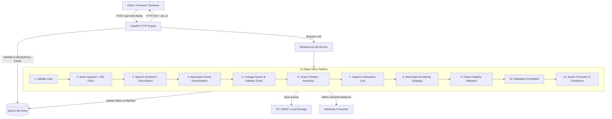

# IncuBrix Script & Voiceover to B-Roll Video Engine

An enterprise-grade, asynchronous video processing engine that transforms narration scripts or voiceovers into licence-clean, timed B-roll videos across multiple aspect ratios (`16:9`, `9:16`, `1:1`) with synchronized subtitles, complete clip lineage, and detailed manifests.

---

## 1. System Architecture



---

## 2. Job Lifecycle and Pipeline Stages

Every video job transitions through deterministic lifecycle states:

```
[queued] ──> [processing] ──> [completed]
                   │
                   └──> [failed]
```

### Supported Job States:
- `queued`: Request accepted and validated; waiting for worker slot.
- `processing`: Actively running the 11-stage video pipeline.
- `completed`: All requested aspect ratios rendered, validated, and promoted to storage.
- `failed`: Terminal failure recorded with structured error and diagnostic information.

### Detailed Progress Stages (0–100%):
| Stage Name | Progress | Description |
|---|---|---|
| `queued` | 0% | Initial state upon submission. |
| `validating` | 5% | Validating script, scene list, or audio parameters. |
| `ingesting_audio` | 15% | Downloading external audio or validating uploaded audio file. |
| `speech_synthesis` | 25% | Synthesizing spoken narration via TTS or transcribing audio. |
| `segmentation` | 35% | Segmenting narration into meaningful scenes aligned with sentence boundaries. |
| `footage_search` | 50% | Searching primary footage source with automatic fallback chain and duplicate clip prevention. |
| `timeline_creation` | 65% | Constructing clip metadata, licence records, and relevance scores. |
| `captions_generation` | 75% | Generating synchronized subtitle timestamps (`captions.srt`). |
| `rendering` | 85% | Rendering normalized 1080p video outputs for all requested aspect ratios into staging. |
| `validating_outputs` | 92% | Verifying output stream integrity, dimensions, duration, and file readability. |
| `metadata_compilation` | 96% | Writing final `timeline.json` and `manifest.json`. |
| `completed` | 100% | Atomically promoting assets to permanent storage and updating job records. |

---

## 3. API Contract and Endpoints

All application routes are served under `/api/v1/`, with root-level health probes conforming to the IncuBrix Integration Standard.

| Method | Endpoint | Description |
|---|---|---|
| `GET` | `/health` | Liveness health probe. |
| `GET` | `/ready` | Readiness probe (database, storage, FFmpeg status). |
| `POST` | `/api/v1/broll/jobs` | Submit a new video job from JSON (`script`, `scenes`, or `audio_url`). Accepts `Idempotency-Key` header. |
| `POST` | `/api/v1/jobs/upload` | Upload audio directly (`.mp3`, `.wav`, `.m4a`) to create a video job. |
| `GET` | `/api/v1/broll/jobs/{id}` | Poll job progress, current stage, and output availability. |
| `GET` | `/api/v1/broll/jobs/{id}/timeline` | Retrieve scene-by-scene clip metadata, licences, and relevance scores. |
| `GET` | `/api/v1/broll/jobs/{id}/manifest` | Retrieve execution manifest (models, cost estimate, timings, licences). |
| `POST` | `/api/v1/broll/jobs/{id}/scenes/{scene_id}/swap` | Swap an individual scene's clip with fast partial re-render. |
| `GET` | `/api/v1/jobs/download/{id}/{file}` | Download output video, captions, timeline, or manifest with directory confinement security. |
| `GET` | `/openapi.yaml` | Complete OpenAPI 3.1 specification. |
| `GET` | `/` or `/docs` | Interactive Web UI / Swagger documentation. |

### Example Request (`POST /api/v1/broll/jobs`):
```bash
curl -X POST http://localhost:8000/api/v1/broll/jobs \
  -H "Content-Type: application/json" \
  -H "Idempotency-Key: unique-key-1001" \
  -d '{
    "script": "A creator records a sixty-second voiceover about saving money and building value.",
    "voice": "en-IN-female",
    "aspect_ratios": ["16:9", "9:16"],
    "style": "bright, modern, real-world footage",
    "avoid": ["people'\''s faces", "alcohol"],
    "captions": {"burn_in": true, "srt": true}
  }'
```

### Example Response (`202 Accepted`):
```json
{
  "job_id": "766c5d9e-1cf0-42ae-811c-bc97e70ea53b",
  "status": "queued",
  "progress": 0,
  "stage": "queued",
  "created_at": "2026-10-15T10:45:00.000Z",
  "started_at": null,
  "completed_at": null,
  "retry_count": 0,
  "result_urls": null,
  "timeline_available": false,
  "manifest_available": false,
  "outputs_available": {},
  "error": null,
  "warnings": []
}
```

---

## 4. Standardized Error Contract

All error responses strictly adhere to the Integration Standard #5 schema:
```json
{
  "error": {
    "code": "UPPER_SNAKE_CASE_CODE",
    "message": "Human-readable description of what went wrong.",
    "retryable": false,
    "details": {}
  }
}
```

### Documented Error Codes:
- `INVALID_INPUT`: Malformed request, empty script, or unsupported aspect ratio.
- `UNSUPPORTED_MEDIA_TYPE`: Uploaded file format is not `.mp3`, `.wav`, or `.m4a`.
- `PAYLOAD_TOO_LARGE`: Audio file exceeds maximum configured upload limit.
- `JOB_NOT_FOUND`: Specified `job_id` does not exist.
- `SCENE_NOT_FOUND`: Specified `scene_id` does not exist within the job timeline.
- `IDEMPOTENCY_CONFLICT`: Re-submission with the same `Idempotency-Key` but mismatched payload parameters.
- `FOOTAGE_NOT_FOUND`: All footage providers in the fallback chain were unable to locate licence-clean footage.
- `TTS_GENERATION_FAILED`: Narration text-to-speech synthesis failed.
- `RENDER_FAILED`: Video encoding, transformation, or output verification failed.
- `STORAGE_ERROR`: Storage backend write/read failure.
- `INTERRUPTED_BY_RESTART`: Server process was restarted while the job was processing.

---

## 5. Quickstart & Local Setup (< 5 Commands)

```bash
# 1. Clone repository and navigate to directory
git clone <repo-url>
cd incubrix

# 2. Install dependencies
python -m pip install -r requirements.txt

# 3. Run automated tests (runs with 0 API keys)
pytest

# 4. Start local development server
python run.py
```
Open **http://localhost:8000** in your browser to access the interactive web interface, or **http://localhost:8000/docs** for Swagger documentation.

---

## 6. Docker Container Execution

```bash
# Start API engine and MinIO object storage with one command
docker compose up -d

# Check health
curl http://localhost:8000/health
```

---

## 7. Configuration Reference (`.env`)

All settings are configured via environment variables with defaults:

| Variable | Default | Purpose |
|---|---|---|
| `PORT` | `8000` | HTTP listening port |
| `STORAGE_BACKEND` | `local` | Storage provider (`local` or `s3`) |
| `LOCAL_STORAGE_DIR` | `./storage` | Directory for output videos and metadata |
| `DATABASE_URL` | `sqlite:///./data/incubrix.db` | SQLite database path |
| `MAX_CONCURRENT_JOBS` | `2` | Bounded worker concurrency limit |
| `FOOTAGE_PRIMARY_PROVIDER`| `mock` | Primary stock provider (`pexels`, `pixabay`, `mock`) |
| `TTS_PROVIDER` | `mock` | Narration TTS provider (`gtts` for real speech, `mock` for offline testing) |
| `DEFAULT_VOICE` | `en-IN-female` | Default voice identifier for TTS |
| `WEBHOOK_SIGNATURE_SECRET`| `incubrix_secret` | Secret for HMAC-SHA256 callback signing |

---

## 8. Text-to-Speech (TTS) Configuration & Operations

IncuBrix supports both real speech synthesis via Google Text-to-Speech (`gtts`) and synthetic sine-wave waveforms (`mock`).

### 1. Enabling Real TTS
Set the environment variable in `.env`:
```bash
TTS_PROVIDER=gtts
DEFAULT_VOICE="en-IN-female"
```
> [!IMPORTANT]
> **Network Requirement**: `gTTS` connects to Google's public TTS endpoints. It requires active internet access from the host or container. No API credentials or keys are required.

### 2. Enabling Mock TTS for Local / Offline Development
Set the environment variable in `.env`:
```bash
TTS_PROVIDER=mock
```
Mock TTS generates deterministic synthetic audio waveforms without internet access, enabling the entire test suite and development pipeline to operate in strictly offline environments.

### 3. Supported Voices and Regional Accents
Voices follow the standard `<lang>-<region>-<gender>` convention:
- `en-IN-female` / `en-IN-male`: English (India accent, `co.in`)
- `en-US-female` / `en-US-male`: English (US accent, `com`)
- `en-GB-female` / `en-GB-male`: English (UK accent, `co.uk`)
- `hi-IN-female` / `hi-IN-male`: Hindi
- `ta-IN-female` / `ta-IN-male`: Tamil
- `te-IN-female` / `te-IN-male`: Telugu

### 4. Verifying Real Narration Output
- **Application Logs**: Look for `GTTSProvider generated X.XXs audio (narration.wav) for N sentences`.
- **Media Inspection**: Probe the resulting narration file or output video with `ffprobe` to verify audio tracks (`pcm_s16le` / `aac` at 24kHz/44.1kHz).
- **Listening Verification**: Download the final video or audio file from `/api/v1/jobs/download/{job_id}/video_16_9.mp4` and listen to the natural spoken voiceover.

### 5. Troubleshooting Network and Generation Failures
If TTS fails during job execution:
- **Error Code `TTS_GENERATION_FAILED` (HTTP 502 / retryable)**: Returned when Google TTS endpoints cannot be reached or socket connection fails.
- **Check DNS & Outbound Connectivity**: Ensure outgoing HTTP/HTTPS connections are permitted by host firewalls or Docker container bridge networks.
- **No Corrupt Files Left**: If synthesis fails midway, IncuBrix automatically purges any partial or temporary files to prevent corrupted video assembly.
- **Empty Narration Validation**: If empty or blank text is submitted, IncuBrix raises `INVALID_INPUT` / `ValueError` before calling external providers.
